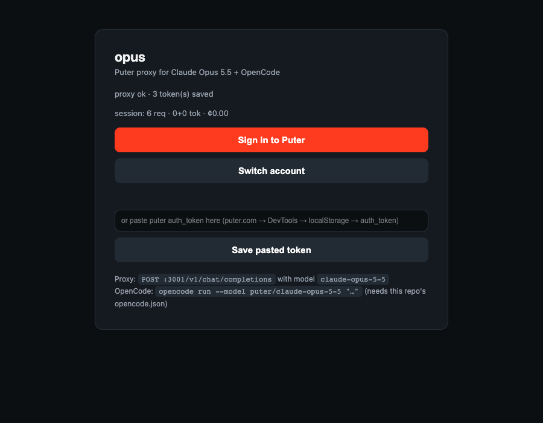
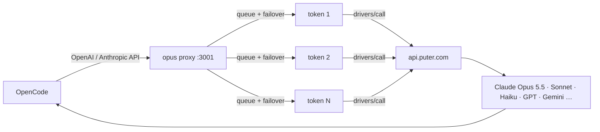

# opus-free 🆓

> **Frontier models, free, in your terminal.** Use Claude Opus 5.5, Sonnet,
> Haiku, GPT, Gemini, DeepSeek and 900+ other models in
> [OpenCode](https://opencode.ai) — routed through your free
> [Puter](https://puter.com) account. No API keys to buy. No card. Ever.


---

## 👀 What you get

`opus` starts a local proxy with a sign-in page. One click authenticates you
with Puter; tokens are verified and pooled automatically.



## ⚙️ How it works



Per request, the proxy:

1. Accepts OpenAI (`/v1/chat/completions`) or Anthropic (`/v1/messages`)
   shapes — **including `tools`/`tool_choice`**, so agents work.
2. Stamps an Anthropic **cache breakpoint** on the system message, making the
   static system+tools prefix bill ~5% on repeat turns (Claude).
3. Sends the call through the token pool (round-robin, serialized —
   Puter rejects parallel calls on one account — with 429 backoff and
   402/429 failover).
4. Buffers upstream, then re-emits **SSE streaming** with valid
   `finish_reason`, and records tokens + ¢ to `/api/usage`.

## 🚀 Quick start

```sh
git clone https://github.com/Parithosh-Varma/opus-free.git && cd opus-free
cp bin/opus ~/bin/opus          # or anywhere on your PATH
opus                            # start proxy + open sign-in page
```

Click **Sign in to Puter** → approve the popup → done. Then:

```sh
cp opencode.json.example ./opencode.json
opencode run --model puter/claude-haiku-5-5 "Reply with exactly: HI"
```

More examples: [`examples/curl.sh`](examples/curl.sh),
[`examples/python_openai.py`](examples/python_openai.py),
[`examples/opencode.md`](examples/opencode.md).

## 📖 `opus` CLI

| Command | Does |
|---|---|
| `opus` | Start proxy on `:3001`, open sign-in UI |
| `opus login` | Reopen the sign-in page anytime |
| `opus status` | Health, model count, saved tokens |
| `opus add-token <tok>` | Save a token manually (puter.com → DevTools → localStorage → `auth_token`) |
| `opus tokens` | List saved accounts (redacted) |
| `opus logs` / `opus stop` | Tail logs / stop proxy |

## 🆚 Why not just…

| Alternative | Gap opus-free fills |
|---|---|
| Raw Puter.js in browser | no OpenCode/tool-call wiring, no pooling, no cost meter |
| Generic OpenAI proxies | drop `tools`, fake streams break agents, no Puter auth flow |
| Paid API keys | this is free (within Puter's free allowance) |

## 💰 Cost cheat-sheet

Puter prices (usd-cents / 1M tokens, in / out):

| Model | In | Out | Role |
|---|---|---|---|
| `claude-opus-5-5` | 400 | 2000 | hard problems only |
| `claude-sonnet-5-5` | 200 | 1000 | main driver — best value |
| `claude-haiku-5-5` | 10 | 50 | **default** + small tasks |
| `deepseek-v4-flash-0731` | 44 | 132 | cheap bulk |
| `gemini-2.5-flash-lite` | 10 | 40 | cheap bulk |
| `gpt-4o-mini` | 15 | 60 | cheap bulk |

> ⚠️ **Read this before your credits vanish:** every message re-sends the
> full conversation as input. A real session billed **158,231 input vs 139
> output tokens**. Mitigate with fresh sessions per task, `/compact` early,
> Haiku for small work — and cache breakpoints (already on) for the rest.

Free Puter accounts get a throttled daily allowance, and Puter now requires
phone verification, so realistically pool 1–3 accounts. `402
insufficient_funds` = dry pool → wait for reset or Switch-account to a second
account via `opus login`.

## 🧠 Memory layer (the other half of saving tokens)

Caching makes repeat context cheap; memory makes it *small*. With
[opencode-supermemory](https://github.com/supermemoryai/opencode-supermemory)
the agent stores decisions across sessions and recalls them on demand —
instead of you carrying a 158K-token history forever.

```sh
bunx opencode-supermemory@latest install --no-tui
bunx opencode-supermemory@latest login     # or set SUPERMEMORY_API_KEY
bunx opencode-supermemory@latest status
cp supermemory.jsonc.example ~/.config/opencode/supermemory.jsonc  # then add your key
```

Then inside OpenCode run `/supermemory-index` once per project so the
codebase structure is memorized up front. The working loop becomes: **fresh
session per task → recall from memory → `/compact` early**. Config template
with both backends (free cloud tier / local server) is in
[`supermemory.jsonc.example`](supermemory.jsonc.example); the example
`opencode.json` already registers the plugin + recall permission.

## 🗂️ Project structure

```text
opus-free/
├── puter-proxy.mjs       # the proxy — zero deps, node >= 20
├── bin/opus              # global CLI
├── opencode.json.example # provider config (Haiku default)
├── supermemory.jsonc.example # memory-layer config template
├── examples/             # curl / python / opencode snippets
└── docs/ui.png           # sign-in page screenshot
```

Runtime state lives outside the repo: `~/.opus/` (tokens, usage, logs) —
nothing credential-like is ever committed.

## 🔌 Endpoints

| Endpoint | Shape |
|---|---|
| `POST /v1/chat/completions` | OpenAI, tools supported |
| `POST /v1/messages` (+ `/anthropic/…`) | Anthropic, tools supported |
| `GET /v1/models` | live Puter model list (~995) |
| `GET /` | sign-in UI + spend meter |
| `GET /api/usage` | spend JSON · `POST /api/save-token` · `GET /healthz` |

Tokens load from `$PUTER_TOKEN` / `$PUTER_TOKENS` and pooled account storage;
the proxy never hardcodes credentials. Env knobs: `PUTER_PROXY_PORT`,
`PUTER_API_BASE_URL`, `REQUEST_TIMEOUT_MS`, `SQLITE_PATH`.

## 🛠️ Troubleshooting

| Symptom | Cause → fix |
|---|---|
| `stream ended without finish_reason` (old versions) | empty stream on upstream error — fixed; update the proxy |
| `402 insufficient_funds` | dry pool → reset wait or second account |
| `429 Usage is reserved` | parallel calls on one account → proxy serializes + retries; add accounts |
| Sign-in popup blocked | call it from the button click (user gesture required) |

## ⚖️ Disclaimer

This pools **your own** Puter free allowance per account — respect Puter's
terms. It's a local dev proxy, not a service to share publicly.

## 📄 License

MIT — see [LICENSE](LICENSE).
